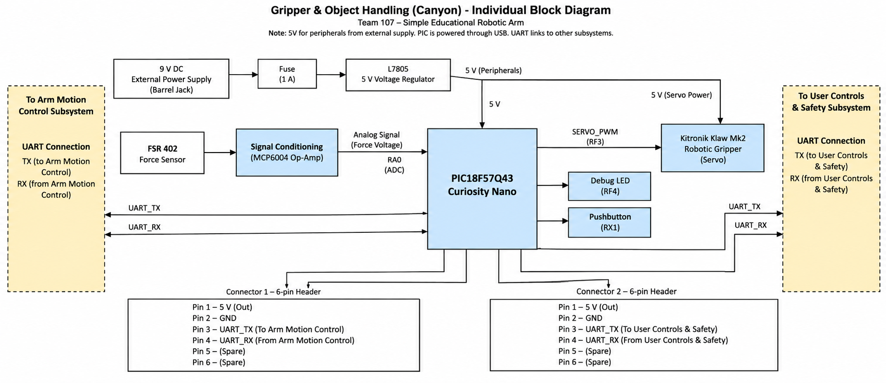

---
## title: Individual Block Diagram

tags:
- Block Diagram
- Gripper
- Object Handling
- PIC18F57Q43
- Robotic Arm

## Overview
The block diagram below is the block diagram showing the Gripper and Object Handling subsystem of the Simple Educational Robotic Arm. In this subsystem, the Gripper servo and the sensors’ input signals are controlled by the PIC18F57Q43 Curiosity Nano microcontroller. The block diagram includes the power supply lines, signal conditioning, microcontroller I/O ports, and other interfaces of the subsystem with the Arm Motion Control and User Controls & Safety subsystems.

## Block Diagram 

