---
**Overview**
Component Selection Process
This page describes the process used to select components for the Gripper & Object Handling subsystem of Team 107's Simple Educational Robotic Arm.

This subsystem relies on a PIC18F57Q43 Curiosity Nano microcontroller to control a servo-mechanized gripper and detect any object through infrared detection and to sense gripper strength through a Force Sensitive Resistor (FSR).

The objective here is to choose low-cost components which would be able to effectively detect and grasp any object as well as to ensure their safe handling.

Total budget for the chosen components is $60. The PIC18F57Q43 Curiosity Nano is already owned and doesn’t need to be purchased.

The following section provides a comparison of alternatives to components in question.
## Component Selection 1: Gripper Servo Motor

The gripper requires a servo motor that can open and close its fingers while remaining compact, affordable, and compatible with the PIC18F57Q43 microcontroller. Three TowerPro servo motors were compared.

### Table 1: Servo Motor Comparison

| Solution | Advantages | Disadvantages | Price |
|---|---|---|---|
| **TowerPro SG90** | Lightweight (9 g); inexpensive; PWM controlled; suitable for small grippers | Plastic gears can wear or strip; limited torque for heavier objects | $4.60 |
| **TowerPro MG90S** | Metal gears improve durability; compact (13.4 g); approximately 1.8 kg·cm stall torque at 4.8 V; PWM controlled | More expensive than SG90; limited torque for heavy objects | $9.00 estimated |
| **TowerPro MG996R** | Metal gears; approximately 9.4 kg·cm stall torque at 4.8 V; suitable for heavier gripping loads | Larger (55 g); requires more current; adds weight to the robotic arm | $11.20 |

### Servo Motor Pictures

| SG90 | MG90S | MG996R |
|:---:|:---:|:---:|
|  |  |  |

### Product Links

- [TowerPro SG90 Digital Servo](https://torqpro.com/product/sg90-digital/)
- [TowerPro MG90S Servo](https://towerpro.com.tw/product/mg90s-3/)
- [TowerPro MG996R Servo](https://torqpro.com/product/mg996r/)

### Selected Component: TowerPro MG90S

**Manufacturer:** TowerPro

**Part Number:** MG90S

**Operating Voltage:** Approximately 4.8–6 V

**Control:** PWM

**Selection Explanation:**

The TowerPro MG90S was selected for the Gripper & Object Handling subsystem because it offers a suitable balance of size, cost, durability, and gripping capability. Its metal gears provide better resistance to mechanical wear than the plastic gears of the SG90. Although the MG996R produces significantly more torque, its larger size and weight make it less suitable for a compact educational gripper.

The MG90S can be controlled using a PWM output from the PIC18F57Q43 microcontroller. A separate regulated servo power rail will be used, with a common ground shared with the microcontroller.

The MG90S is the preferred choice pending verification that its torque is sufficient for the intended gripper mechanism and object weight.

## Component Selection 2: Object Detection Sensor

The gripper requires an object detection sensor to determine when an object is positioned near the gripping fingers. Three sensors were compared based on cost, detection capability, circuit complexity, and compatibility with the PIC18F57Q43.

### Table 2: Object Sensor Comparison

| Solution | Advantages | Disadvantages | Reference Price |
|---|---|---|---|
| **Vishay TCRT5000** | Compact; low-cost reflective infrared sensing; compatible with a simple transistor interface; suitable for close-range object detection | Detection depends on object reflectivity and distance; requires resistors and signal conditioning | $3.39 (TCRT5000-based module) |
| **Vishay CNY70** | Very inexpensive; compact; simple phototransistor output; low component count | Very short sensing distance; sensitive to object surface and alignment | $0.95 |
| **ST VL53L0X with Adafruit breakout** | Measures distance rather than reflected intensity alone; longer detection range; digital I²C interface | More expensive; requires additional firmware; changes the interface used in the existing block diagram | $14.95 |

### Object Sensor Pictures

| TCRT5000 | CNY70 | VL53L0X |
|:---:|:---:|:---:|
| 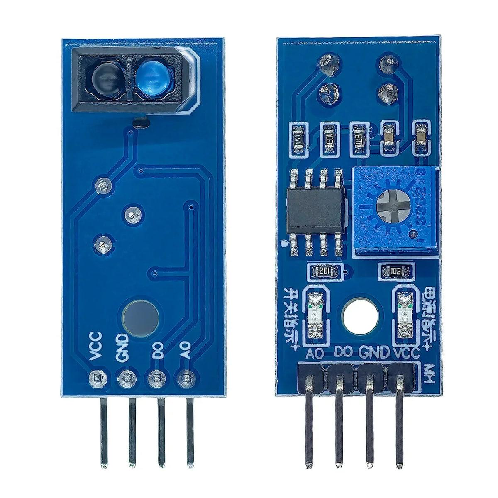 | 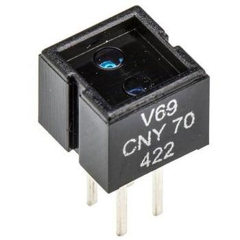 | 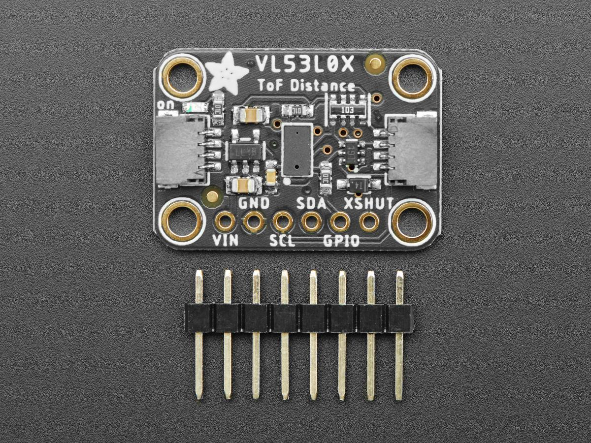 |

### Product Links

- [TCRT5000 infrared sensor module](https://longan-labs.cc/products/2030007)
- [Vishay CNY70 reflective sensor](https://www.addicore.com/products/reflective-optical-sensor-cny70)
- [Adafruit VL53L0X distance sensor](https://www.adafruit.com/product/3317)

### Selected Component: Vishay TCRT5000

**Manufacturer:** Vishay

**Part Number:** TCRT5000

**Sensor Type:** Reflective infrared proximity sensor

**Microcontroller Connection:** RB5 GPIO input through signal-conditioning circuitry

**Selection Explanation:**

The Vishay TCRT5000 was selected because it provides a compact and economical method of detecting objects near the gripper fingers. Its reflective infrared sensing method is appropriate for short-range detection, while its phototransistor output can be interfaced with the PIC18F57Q43 using suitable resistors and a pull-up circuit.

The CNY70 is less expensive but has a shorter practical sensing range. The VL53L0X offers more advanced distance measurement but introduces additional cost and firmware complexity.

The TCRT5000 is therefore the preferred choice for this educational robotic gripper. The final sensor position and detection threshold will be tested with the intended objects.

**Price Note:** The $3.39 reference is for a TCRT5000-based sensor module, not necessarily the bare Vishay TCRT5000. The final bill of materials will use the price of the exact version purchased.

## Component Selection 3: Grip Force Sensor

The gripper requires a force sensor to monitor contact pressure and reduce the risk of damaging objects. Three sensor options were compared based on size, cost, circuit complexity, and compatibility with the PIC18F57Q43.

### Table 3: Grip Force Sensor Comparison

| Solution | Advantages | Disadvantages | Price |
|---|---|---|---|
| **Interlink FSR 402** | Thin and lightweight; simple voltage-divider interface; suitable for detecting grip pressure | Nonlinear output; not ideal for precise force measurement | $2.99 |
| **Interlink FSR 400** | Compact sensing area; lightweight; compatible with analog measurement | Small sensing area; nonlinear output; mounting alignment matters | $2.99 |
| **SparkFun TAL220 Load Cell** | Better suited to calibrated force measurements; useful for quantitative force feedback | Requires an amplifier or ADC interface; more complicated mechanical mounting | $12.95 |

### Grip Force Sensor Pictures

| FSR 402 | FSR 400 | TAL220 |
|:---:|:---:|:---:|
| 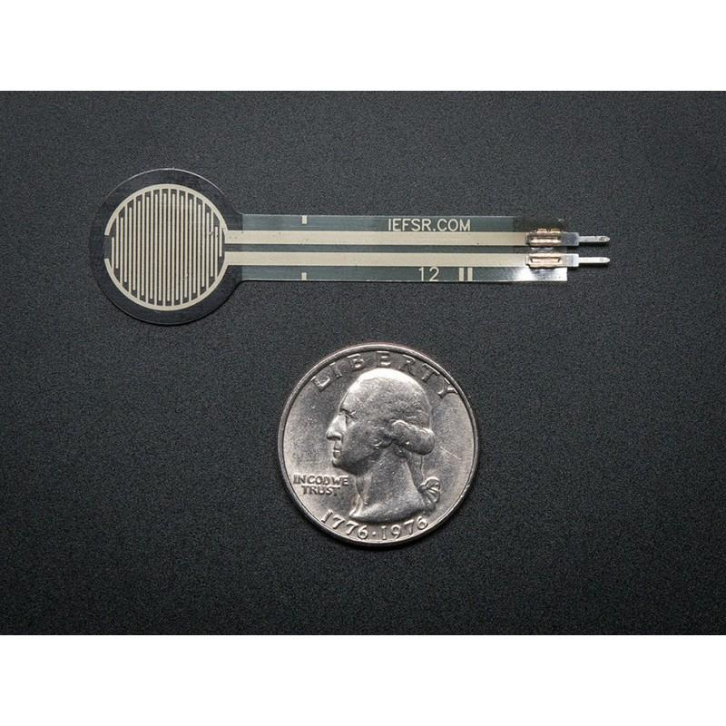 | 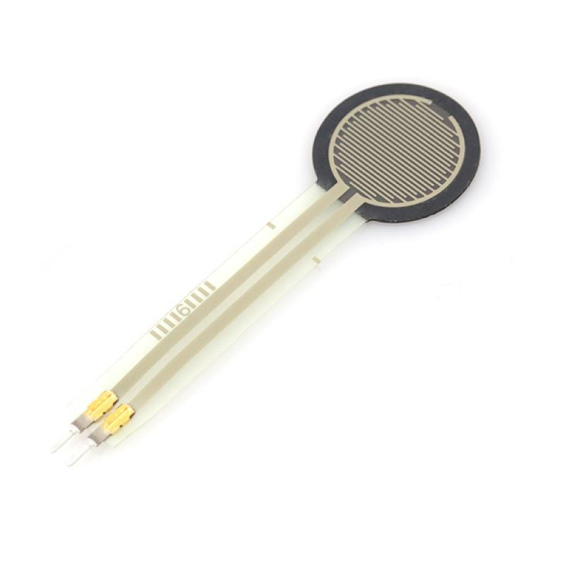 | 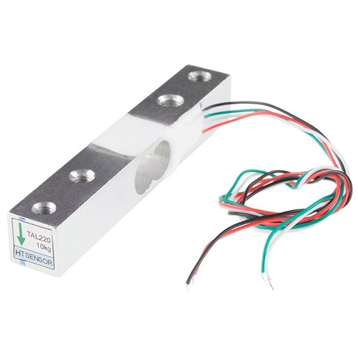 |

### Product Links

- [Interlink FSR 402 — $2.99](https://buyinterlinkelectronics.com/products/fsr-model-402)
- [Interlink FSR 400 — $2.99](https://buyinterlinkelectronics.com/products/fsr-model-400)
- [SparkFun TAL220 10kg Load Cell — $12.95](https://www.sparkfun.com/sensors/weight.html)

### Selected Component: Interlink FSR 402

**Manufacturer:** Interlink Electronics

**Part Number:** FSR 402 (30-81794)

**Sensor Type:** Force-sensitive resistor

**Microcontroller Connection:** RA0/ANA0 analog input through a voltage divider

**Selection Explanation:**

The Interlink FSR 402 was selected because it provides a lightweight and relatively inexpensive way to detect gripping pressure. Its thin sensing area can be incorporated into a gripper finger without requiring a complicated mechanical assembly.

The FSR 400 is also compact but has a smaller sensing area. A TAL220 load cell is more appropriate when calibrated force measurement is needed, but it requires additional electronics and mechanical integration.

The FSR 402 is suitable for monitoring relative grip pressure rather than measuring precise force. Its voltage-divider output can be read by the PIC18F57Q43 ADC to help the controller adjust the gripper servo and avoid excessive pressure on objects.

The final resistance values, sensor mounting, and grip thresholds will be established during testing.

## Component Selection 4: Gripper Mechanism

The gripper mechanism must open and close around lightweight objects while remaining compact and affordable. Three commercial mechanisms were compared.

### Table 4: Gripper Mechanism Comparison

| Solution | Advantages | Disadvantages | Reference Price |
|---|---|---|---|
| **Kitronik Klaw MK2** | Low cost; servo-operated design; educational assembly kit | Servo compatibility and mounting require verification; plastic construction | $11.94 |
| **Lynxmotion A Style Gripper Kit** | Mechanical gripper designed for robotics; larger jaw opening; separate servo selection | Requires a compatible servo and mounting hardware; larger mechanism | $13.08 |
| **Pololu Micro Gripper Kit with Position Feedback Servo** | Compact; parallel gripping jaws; included feedback servo | More expensive; included servo would replace the planned MG90S | $29.95 |

### Gripper Mechanism Pictures

| Kitronik Klaw MK2 | Lynxmotion A Style | Pololu Micro Gripper |
|:---:|:---:|:---:|
| 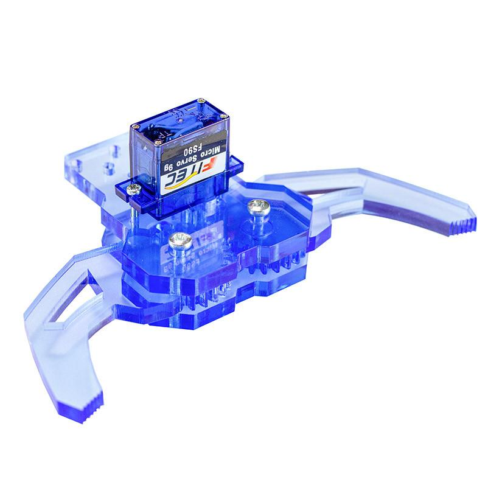 | 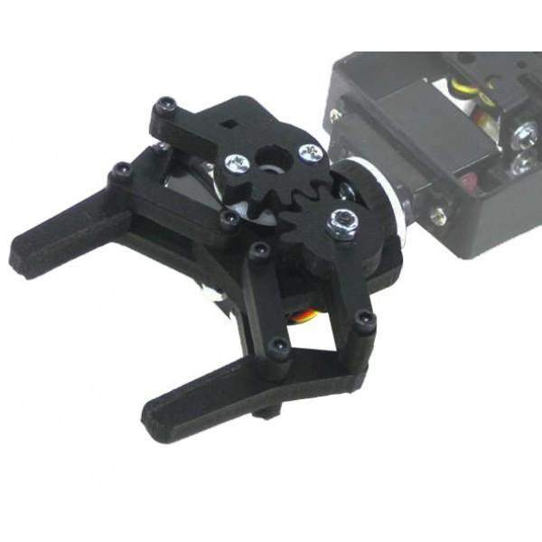 | 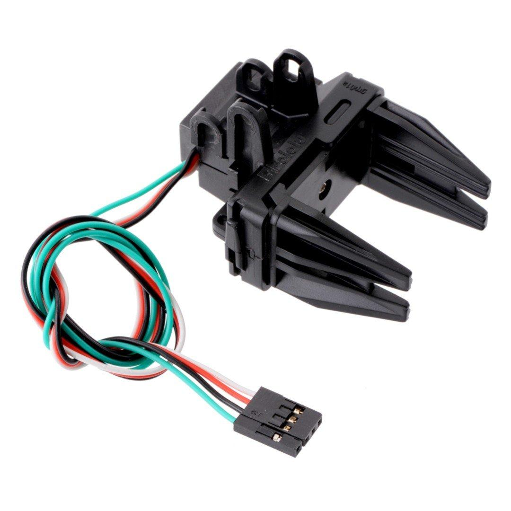 |

### Product Links

- [Kitronik Klaw MK2](https://www.robotshop.com/products/kitronik-klaw-mk2-robotic-gripper-kit)
- [Lynxmotion A Style Gripper Kit](https://www.robotshop.com/products/lynxmotion-a-style-gripper-kit)
- [Pololu Micro Gripper Kit](https://www.robotshop.com/products/pololu-micro-gripper-kit-position-feedback-servo)

### Preferred Component: Kitronik Klaw MK2

**Manufacturer:** Kitronik

**Product:** Klaw MK2 Robotic Gripper Kit

**Reference Price:** $11.94

**Selection Explanation:**

The Kitronik Klaw MK2 is the preferred mechanical gripper because it offers a low-cost servo-operated mechanism suitable for an educational robotic arm. It is more affordable than the other compared options, leaving additional budget for sensors, power regulation, and wiring.

Before finalizing this selection, the team must confirm that the mechanism can accommodate the TowerPro MG90S servo, that the available torque is sufficient, and that the force sensor can be mounted on a gripping surface. If these requirements cannot be met, an alternative gripper mechanism will be selected.

## Component Selection 5: Power Supply and Voltage Regulation

The Gripper & Object Handling subsystem requires regulated power for the PIC18F57Q43 microcontroller, object detection sensor, force sensor, and servo motor. The design uses a USB power source and must provide a stable supply voltage while maintaining a common ground between components.

Three voltage regulator options were compared based on cost, output current, efficiency, and ease of integration.

### Table 5: Voltage Regulator Comparison

| Solution | Advantages | Disadvantages | Reference Price |
|---|---|---|---|
| **ST L7805CV Linear Regulator** | Simple circuit; regulated 5 V output; widely available; low electrical noise | Requires sufficient input voltage above 5 V; dissipates heat; limited output current | Approximately $1–$2 |
| **Texas Instruments LM2940CT-5.0 Linear Regulator** | Regulated 5 V output; lower dropout than a traditional 7805; relatively simple circuit | Still requires input voltage above 5 V; dissipates heat; capacitor requirements must be followed | Approximately $2–$4 |
| **Pololu D24V22F5 Switching Regulator** | Regulated 5 V output; high efficiency; suitable for higher current loads | More expensive; switching noise; not a linear regulator | Approximately $10–$15 |

### Voltage Regulator Pictures

| ST L7805CV | TI LM2940 | Pololu D24V22F5 |
|:---:|:---:|:---:|
| 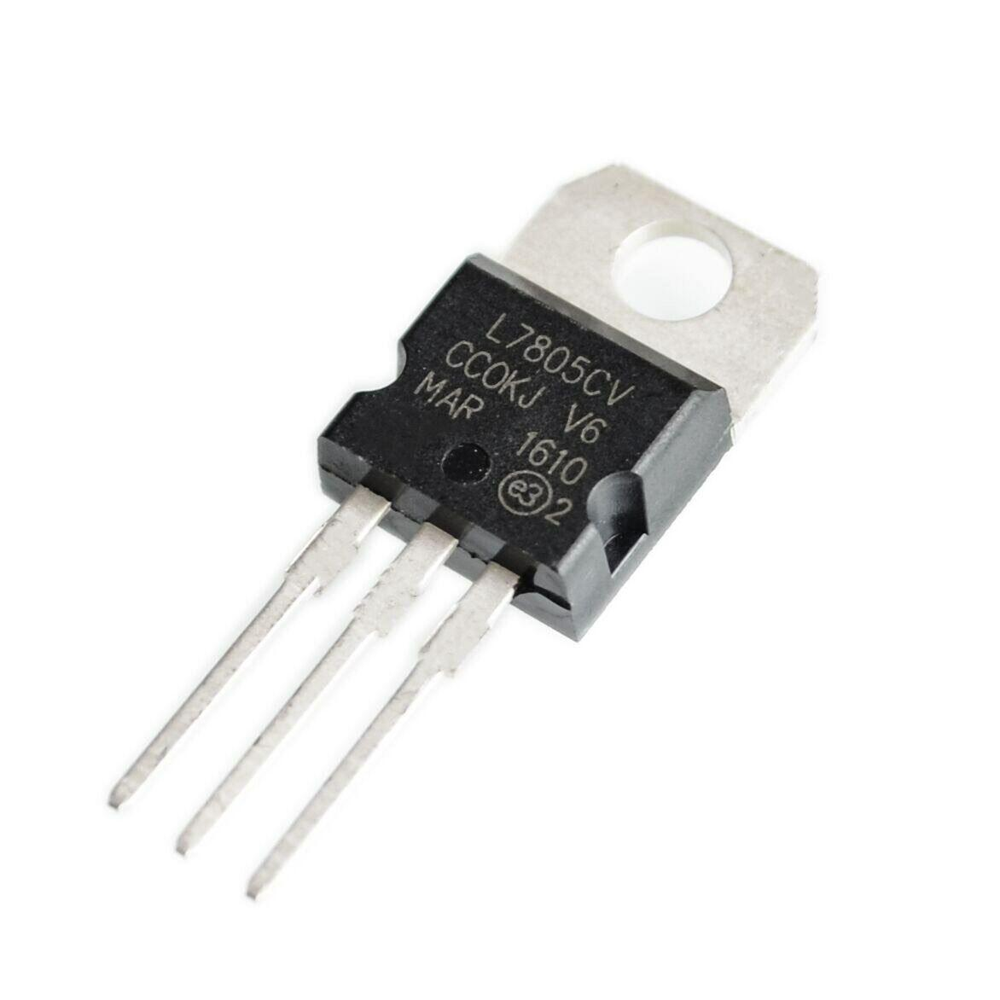 | 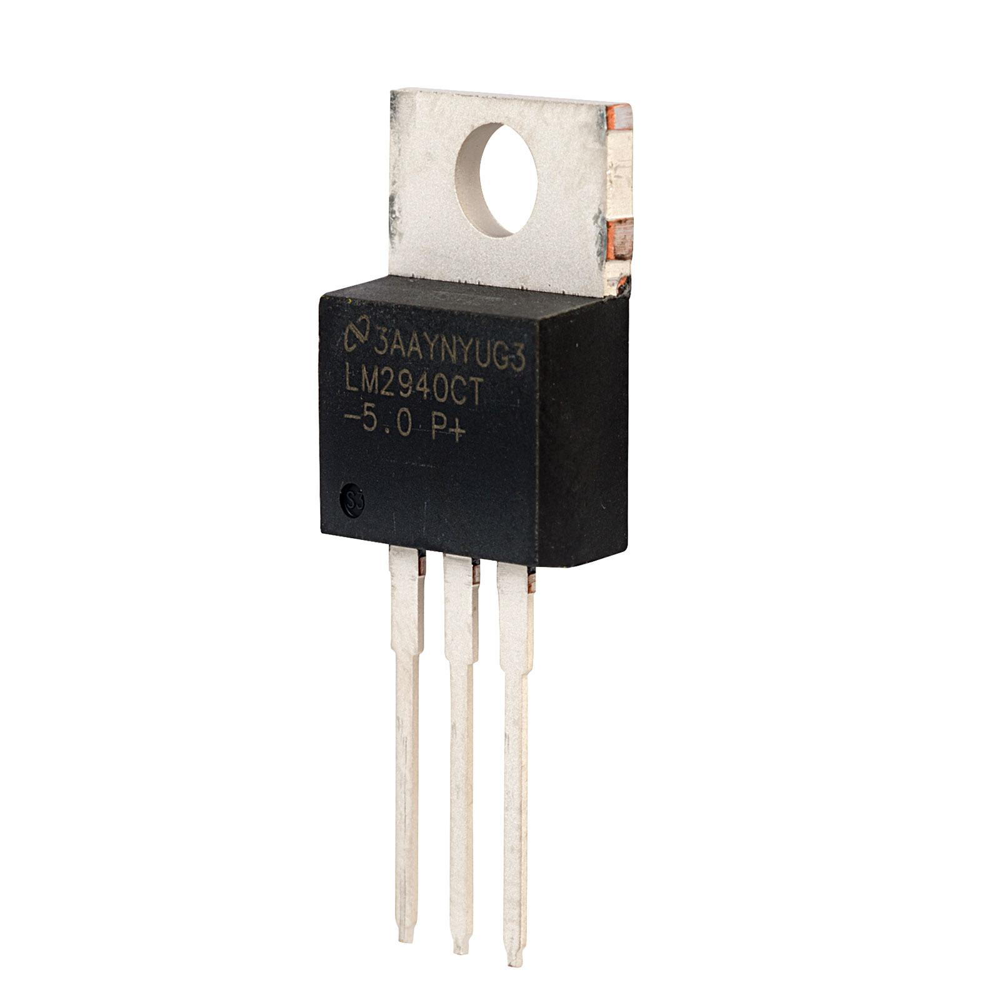 | 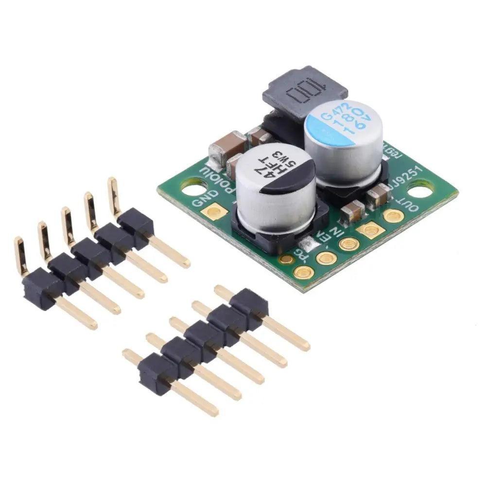 |

### Product Links

- [ST L7805CV regulator](https://www.st.com/en/power-management/l78.html)
- [Texas Instruments LM2940 regulator](https://www.ti.com/product/LM2940-N)
- [Pololu voltage regulator products](https://www.pololu.com/category/131/step-down-voltage-regulators)

### Preferred Regulation Approach

**External Power Supply:** Regulated 5 V DC

**Servo Supply:** 5 V DC directly from the external supply, provided sufficient current is available

**Logic Supply:** 3.3 V using a suitable low-dropout linear regulator or the Curiosity Nano's approved onboard power arrangement

**Candidate 3.3 V Regulator:** Microchip MCP1700-3302 (pending current and board-power verification)

**Selection Explanation:**

The Gripper & Object Handling subsystem uses a regulated external 5 V DC supply. Because this supply already provides the nominal operating voltage required by the MG90S servo, a separate 5 V regulator is unnecessary. The servo will connect to the 5 V power rail rather than a microcontroller output pin.

The PIC18F57Q43 and associated sensor interfaces will operate at compatible 3.3 V logic levels. A suitable 3.3 V low-dropout linear regulator may be used where an external logic supply is required, subject to verification of the Curiosity Nano board's approved power configuration and total current consumption.

The L7805CV, LM2940, and D24V22F5 were compared as 5 V regulation alternatives, but none is selected to regulate an existing 5 V input to 5 V.

The servo and microcontroller circuits will share a common ground. Power-supply current capacity, decoupling capacitors, and wiring will be verified before construction.

**Final Power Approach:** External regulated 5 V supply with a compatible 3.3 V logic power arrangement.

## PIC18F57Q43 Pin Connections

The following table documents the planned microcontroller connections for the Gripper & Object Handling subsystem. Pin assignments will be verified against the PIC18F57Q43 Curiosity Nano pinout and the team block diagram before final PCB design.

### Table 6: Microcontroller Pin Assignments

| PIC Pin | Signal Name | Connected Component | Signal Type | Function |
|---|---|---|---|---|
| RB3 | SERVO_PWM | TowerPro MG90S servo | Digital PWM output | Controls gripper opening and closing |
| RB5 | OBJECT_DETECT | TCRT5000 sensor interface | Digital input | Detects an object near the gripper |
| RA0 / ANA0 | FSR_INPUT | Interlink FSR 402 voltage divider | Analog input | Measures relative gripping pressure |
| RD0 | SAFE_OK | Team connector | Digital | Safety permission signal |
| RD1 | RUN_REQ | Team connector | Digital | Run request signal |
| RD2 | GRP_CMD | Team connector | Digital | Gripper command signal |
| RD3 | OBJ_HELD | Team connector | Digital | Indicates an object is held |
| RD4 | ARM_IN_POS | Team connector | Digital | Indicates the arm is positioned |
| RA1 / ANA1 | SPEED_SET | Team connector | Analog | Speed setting signal |
| RA2 / ANA2 | GRIP_FORCE | Team connector | Analog | Grip force feedback signal |
| GND | GND | Power supply and team connectors | Ground | Shared electrical reference |

### Team Connector Interface

The gripper subsystem uses two planned 8-pin ribbon-cable connectors to interface with the other robotic arm subsystems. Each connector uses the same signal ordering.

| Connector Pin | Signal | PIC Connection |
|---|---|---|
| 1 | SAFE_OK | RD0 |
| 2 | RUN_REQ | RD1 |
| 3 | GRP_CMD | RD2 |
| 4 | OBJ_HELD | RD3 |
| 5 | ARM_IN_POS | RD4 |
| 6 | SPEED_SET | RA1 / ANA1 |
| 7 | GRIP_FORCE | RA2 / ANA2 |
| 8 | GND | GND |

**Design Note:** Signal directions, physical header pin numbering, analog voltage limits, and PIC peripheral pin assignments must be checked against the final team interface agreement and hardware documentation. The connectors must not carry servo motor power unless specifically designed and rated for that purpose.
 

