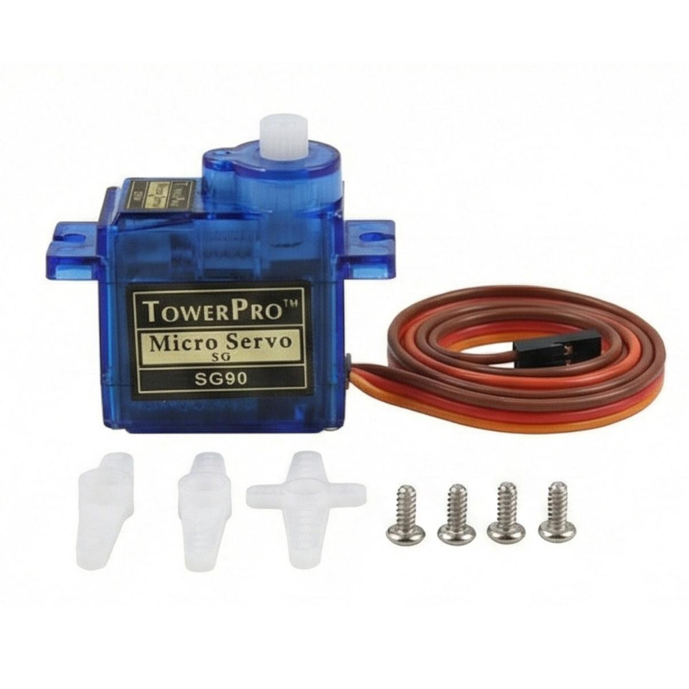
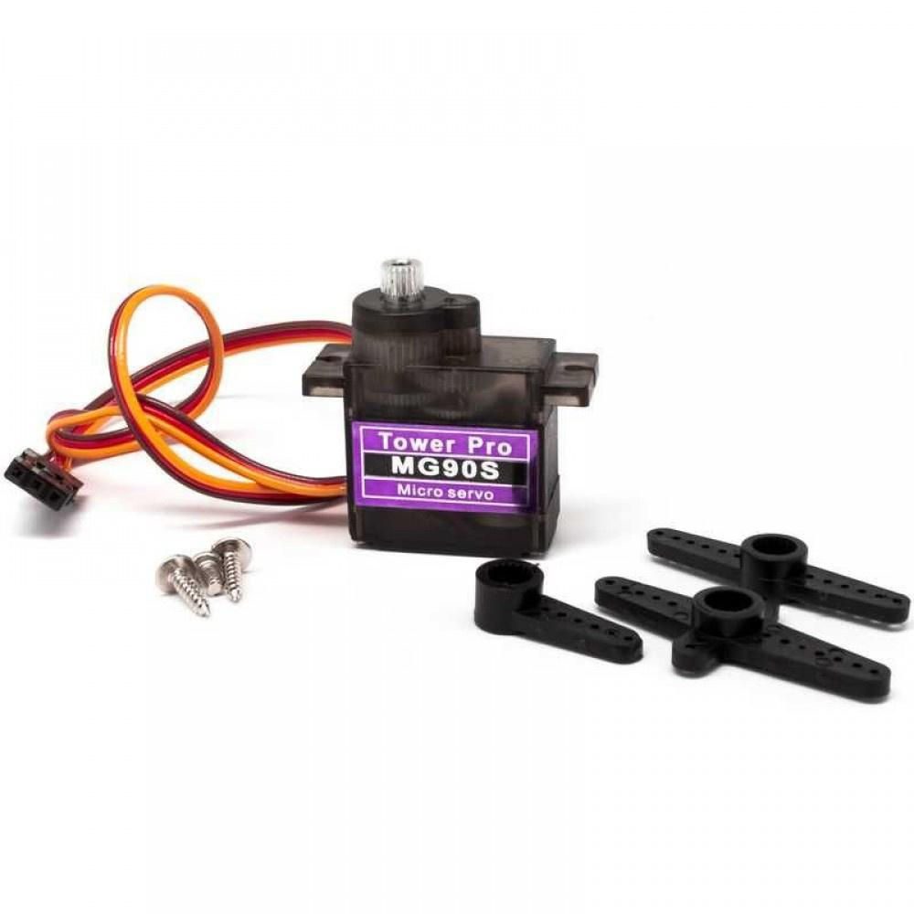
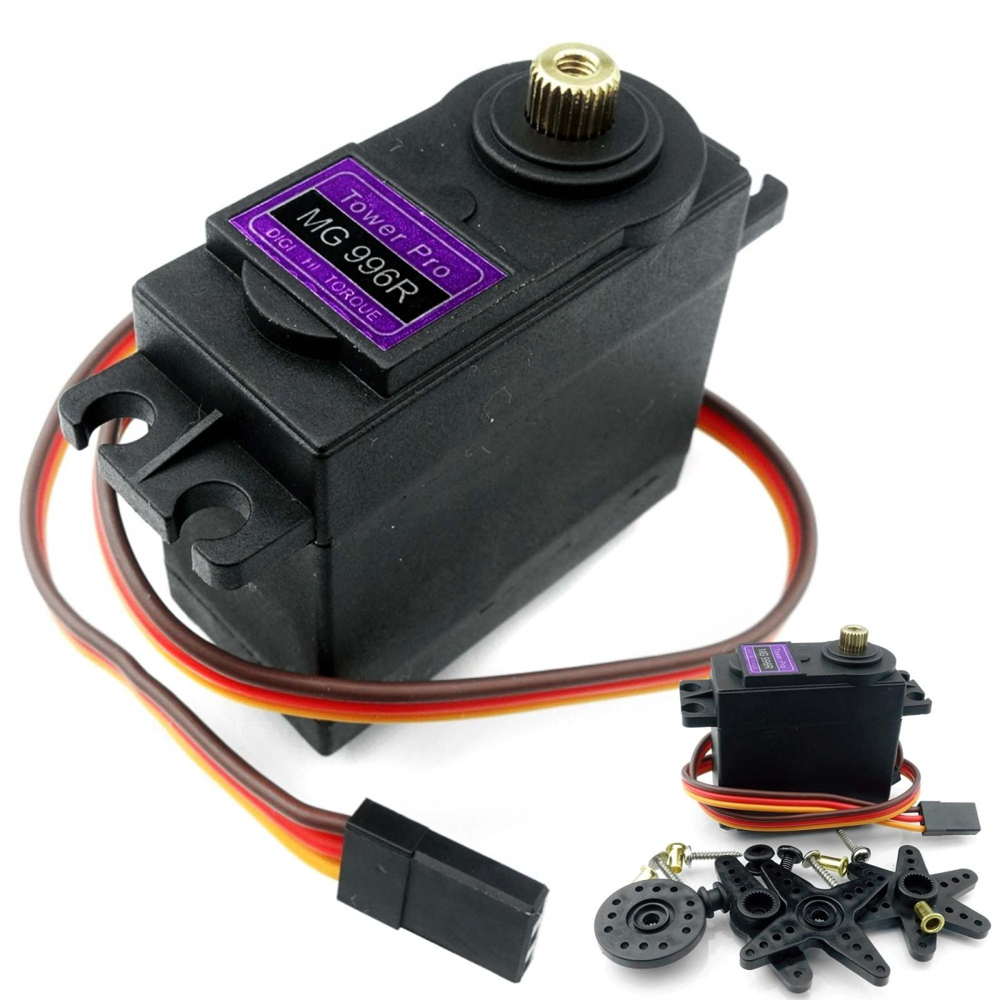

---
**Overview**
Component Selection Process
This page describes the process used to select components for the Gripper & Object Handling subsystem of Team 107's Simple Educational Robotic Arm.

This subsystem relies on a PIC18F57Q43 Curiosity Nano microcontroller to control a servo-mechanized gripper and detect any object through infrared detection and to sense gripper strength through a Force Sensitive Resistor (FSR).

The objective here is to choose low-cost components which would be able to effectively detect and grasp any object as well as to ensure their safe handling.

Total budget for the chosen components is $60. The PIC18F57Q43 Curiosity Nano is already owned and doesn’t need to be purchased.

The following section provides a comparison of alternatives to components in question.
## Component Selection 1: Gripper Servo Motor

The gripper requires a servo motor that can open and close its fingers while remaining compact, affordable, and compatible with the PIC18F57Q43 microcontroller. Three TowerPro servo motors were compared.

### Table 1: Servo Motor Comparison

| Solution | Advantages | Disadvantages | Price |
|---|---|---|---|
| **TowerPro SG90** | Lightweight (9 g); inexpensive; PWM controlled; suitable for small grippers | Plastic gears can wear or strip; limited torque for heavier objects | $4.60 |
| **TowerPro MG90S** | Metal gears improve durability; compact (13.4 g); approximately 1.8 kg·cm stall torque at 4.8 V; PWM controlled | More expensive than SG90; limited torque for heavy objects | $9.00 estimated |
| **TowerPro MG996R** | Metal gears; approximately 9.4 kg·cm stall torque at 4.8 V; suitable for heavier gripping loads | Larger (55 g); requires more current; adds weight to the robotic arm | $11.20 |

### Servo Motor Pictures

| SG90 | MG90S | MG996R |
|:---:|:---:|:---:|
|  |  |  |
### Product Links

- [TowerPro SG90 Digital Servo](https://torqpro.com/product/sg90-digital/)
- [TowerPro MG90S Servo](https://towerpro.com.tw/product/mg90s-3/)
- [TowerPro MG996R Servo](https://torqpro.com/product/mg996r/)

### Selected Component: TowerPro MG90S

**Manufacturer:** TowerPro

**Part Number:** MG90S

**Operating Voltage:** Approximately 4.8–6 V

**Control:** PWM

**Selection Explanation:**

The TowerPro MG90S was selected for the Gripper & Object Handling subsystem because it offers a suitable balance of size, cost, durability, and gripping capability. Its metal gears provide better resistance to mechanical wear than the plastic gears of the SG90. Although the MG996R produces significantly more torque, its larger size and weight make it less suitable for a compact educational gripper.

The MG90S can be controlled using a PWM output from the PIC18F57Q43 microcontroller. A separate regulated servo power rail will be used, with a common ground shared with the microcontroller.

The MG90S is the preferred choice pending verification that its torque is sufficient for the intended gripper mechanism and object weight.

 
**Choice:** Option 2: CTX936TR-ND surface mount oscillator

**Rationale:** A clock oscillator is easier to work with because it requires no external circuitry in order to interface with the PSoC. This is particularly important because we are not sure of the electrical characteristics of the PCB, which could affect the oscillation of a crystal. While the shipping speed is slow, according to the website if we order this week it will arrive within 3 weeks.
