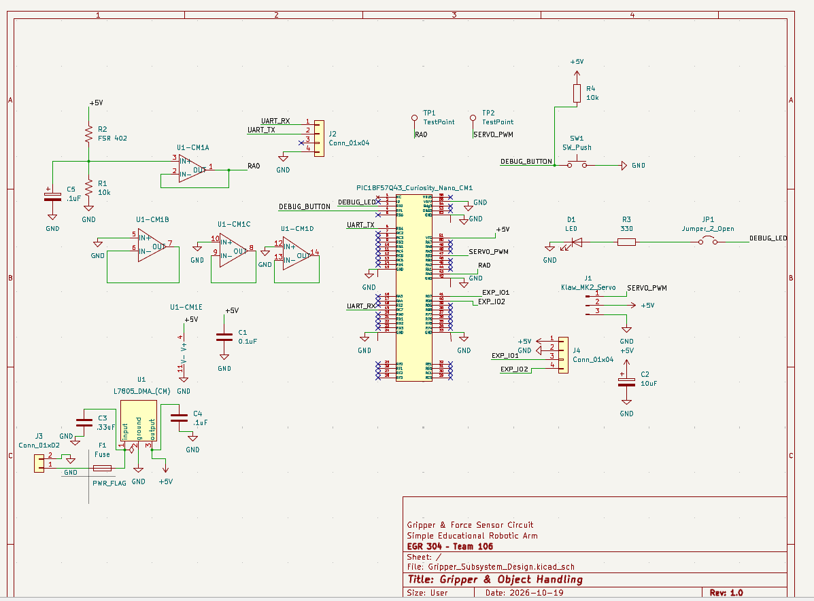

## Overview

The Gripper & Force Sensor Circuit is designed for the Simple Educational Robotic Arm project in EGR 304.

This subsystem controls the robotic arm's gripper servo motor and monitors gripping force using a force-sensitive resistor (FSR 402).

The circuit uses a PIC18F57Q43 Curiosity Nano microcontroller to generate the servo control signal and read the force sensor through an analog input.

An MCP6004 operational amplifier buffers the force sensor signal. A 9 V external power supply and L7805 voltage regulator provide a nominal 5 V supply for the external circuitry.

Additional features include a debug LED, pushbutton, UART interface, and expansion connections.

## Schematic

[View Gripper Subsystem Schematic (PDF)](Gripper_Subsystem_Design.pdf)

**Figure 1:** Gripper and Force Sensor Circuit schematic.

## Resources

The following design files are available:

- [Download Schematic PDF](Gripper_Subsystem_Design.pdf)
- [Download KiCad Project ZIP](Gripper_Subsystem_Design.zip)

The ZIP archive contains the KiCad project files for the gripper subsystem.
