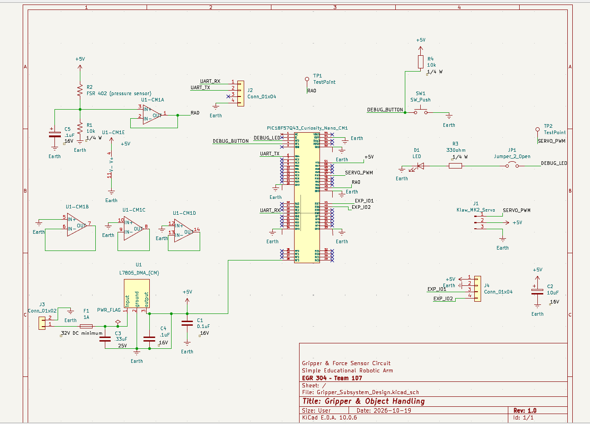

## Overview

The Gripper & Force Sensor Circuit is designed for the Simple Educational Robotic Arm project in EGR 304.

This subsystem controls the robotic arm's gripper servo motor and monitors gripping force using a force-sensitive resistor (FSR 402).

The circuit uses a PIC18F57Q43 Curiosity Nano microcontroller to generate the servo control signal and read the force sensor through an analog input.

An MCP6004 operational amplifier buffers the force sensor signal. A 9 V external power supply and L7805 voltage regulator provide a nominal 5 V supply for the external circuitry.

Additional features include a debug LED, pushbutton, UART interface, and expansion connections.

## Circuit Functionality

The Gripper and Object Handling subsystem is responsible for opening and closing the robotic arm's gripper while monitoring the force applied to an object.

**Force Sensor and Signal Conditioning:** The FSR 402 force-sensitive resistor changes resistance when pressure is applied. Together with a 10 kΩ resistor, it produces a voltage that changes with gripping force. The MCP6004 operational amplifier conditions this signal before it reaches the PIC18F57Q43 microcontroller's RA0 analog input.

**Microcontroller Control:** The PIC18F57Q43 Curiosity Nano reads the force sensor signal through its analog-to-digital converter (ADC). The microcontroller is intended to use this information to monitor gripping force and adjust the servo control signal.

**Servo Gripper:** The Kitronik Klaw Mk2 uses a servo motor to open and close the gripper. The PIC generates a PWM-based servo control signal through the SERVO_PWM connection.

**Power Supply:** A 9 V external input is connected to an L7805 linear voltage regulator, which provides a nominal 5 V supply for the external electronics. The PIC Curiosity Nano is powered separately through USB. The regulator's current and thermal capacity must be verified against the servo's startup and stall requirements before physical operation.

**Communication and Debugging:** UART_RX and UART_TX connections allow communication with other robotic arm subsystems. A debug LED, pushbutton, and test points provide additional ways to monitor and troubleshoot the circuit.

**Product Requirements:** This design supports the robotic arm's object-handling function by combining servo-controlled gripping, force sensing, and communication with the other subsystems. The force feedback is intended to help the system grip objects without applying excessive pressure.

## Schematic

[View Gripper Subsystem Schematic (PDF)](Gripper_Subsystem_Design.pdf)

**Figure 1:** Gripper and Force Sensor Circuit schematic.

## Resources

The following design files are available:

- [Download Schematic PDF](Gripper_Subsystem_Design.pdf)
- [Download Updated KiCad Project ZIP](Gripper_Subsystem_Design_Updated.zip)

The ZIP archive contains the KiCad project files for the gripper subsystem.
