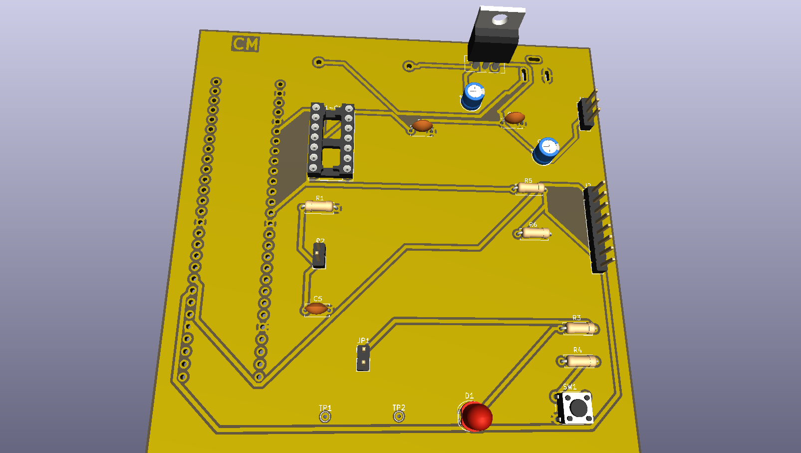
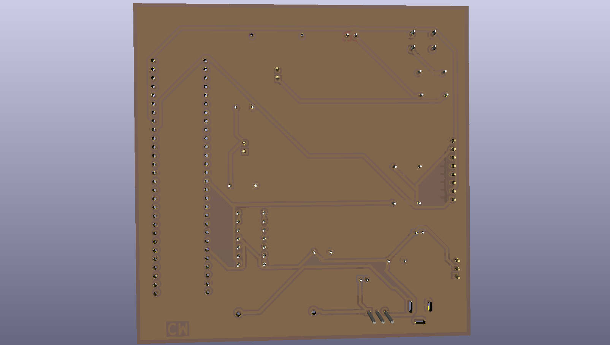
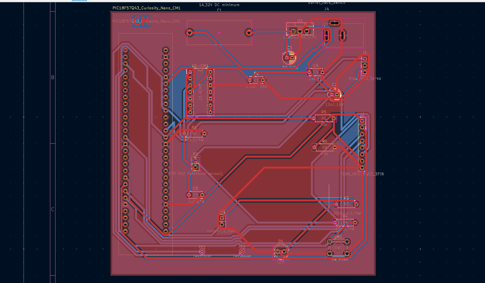

# PCB Design

## Overview

This page documents the PCB design for the Gripper & Object Handling subsystem of Team 107's Simple Educational Robotic Arm project for EGR 304: Embedded Systems Design.

The PCB was designed using KiCad and incorporates the PIC18F57Q43 Curiosity Nano microcontroller, MCP6004 operational amplifier, FSR 402 force sensor interface, and Kitronik Klaw Mk2 servo gripper interface.

The board also includes power regulation, supporting passive components, debugging features, and connections for communication with the other robotic arm subsystems.

## PCB Layout

The PCB uses a two-layer design with front and back copper routing. The board was designed within the 100 mm × 100 mm size requirement.

### Front PCB View

### Back PCB View

## PCB Layout Overview

The following image shows the completed two-layer
PCB layout designed in KiCad, including component
placement and copper routing.

## Design Verification

The completed PCB was checked using KiCad's Design Rules Checker (DRC).

The final DRC results showed:

- **0 errors**
- **0 warnings**
- **0 unconnected items**
- **0 schematic parity errors**

The Gerber and drill files were also generated and analyzed using JLCPCB's Design for Manufacturing (DFM) checking tool.

## PCB Manufacturing Files

The Gerber and drill files for the Gripper & Object
Handling subsystem PCB were generated using KiCad.

These files can be used for PCB manufacturing.

[Download PCB Gerber Files](Gripper_Subsystem_Gerbers.zip.zip)
## KiCad Project Files

The complete KiCad design project, including the schematic, PCB layout, and custom footprint libraries, is provided below.

*KiCad project ZIP download link will be added here.*

## PCB Layout PDF

*Front and back PCB layout PDF download link will be added here.*
